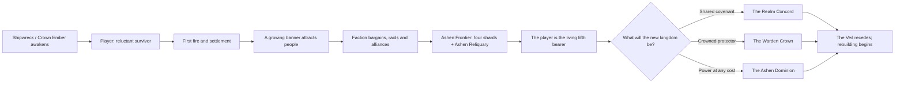

# Rise of the Realm — Story Bible

**Purpose:** the canonical narrative direction for the next game update. It turns
the existing survival, settlement, faction, Ashen Frontier, shard, raid, and
kingdom systems into one player-driven story.

**Updated market direction (September 2026):** a **cozy-dark survival kingdom
RPG**. The emotional rhythm is *shelter, belonging, dread, responsibility*:
players make a beautiful, useful home in a frontier that is quietly becoming
wrong. This is a better fit than a cutscene-heavy epic or a pure sandbox because
it gives the existing gathering, building, recruitment, combat, and exploration
systems a single emotional purpose.

## One-sentence promise

A shipwrecked nobody discovers they are the missing living piece of a broken
ancient barrier, then must decide whether the kingdom they build becomes the
wall that protects the realm or the crown that controls it.

## Why this direction is worth building

Recent Steam analysis shows both narrative games and open-world survival-craft
games finding meaningful audience success, but discoverability is brutal: more
than 20,000 games released on Steam in 2025. The answer is a clear, legible
hybrid—not “an RPG with every feature.” Our differentiator is **build a refuge
against a beautiful, intimate apocalypse**.

The story should follow four player expectations without copying any one game:

1. **A strong emotional premise in the first ten minutes.** “The barrier saved
   you and hurt the realm” is understandable before the lore becomes complex.
2. **Narrative through verbs.** Gathering keeps people fed; walls change raids;
   recruits alter the town; faction policy changes prices, routes, and who
   appears. The player sees their story in play, not only in dialogue.
3. **Persistent local consequences, not branch explosion.** Choices change the
   state of settlements, NPC relationships, available support, and ending
   conditions, while the campaign remains producible on a small team.
4. **Hopeful restoration with controlled dread.** The safe town is warm,
   communal, and customizable. Beyond its light are quiet horrors, hard
   trade-offs, and a mystery worth chasing.

### Product pillars

| Pillar | Player feeling | Existing systems that carry it | Required story proof |
|---|---|---|---|
| Build the light | “This place exists because I made it.” | Building, crafting, population, economy | Every settlement stage visibly changes people’s safety and dialogue. |
| Follow the wound | “Something is wrong, and I can understand it.” | Exploration, ruins, books, shards, bosses | Each region supplies a clue, a question, and a lasting change. |
| Choose the burden | “My leadership has a cost.” | Factions, trade, raids, kingdom status | Each policy grants a benefit and creates a problem the player must own. |
| Keep the frontier alive | “The world remembers what I did.” | Dynamic events, NPCs, saves, POIs | Rescues, raids, cleanses, and alliances leave persistent traces. |

### The repeatable story loop

```text
Danger reaches a frontier community
        ↓
Explore the affected place and learn who is hurt
        ↓
Fight, gather, negotiate, or build a solution
        ↓
Return with a visible change: a person, route, service, ally, or scar
        ↓
The safer/stronger kingdom attracts a larger moral problem
```

This lets procedural events feel authored: a rescue can add a named settler and
a shortage; a cleansed Veil bloom can restore a resource node; a saved merchant
can open a route; a repelled raid can leave an Ashen deserter seeking amnesty.

## Canon foundations to retain

- The player reaches the unnamed frontier after the loss of the last ship bound
  for the Golden Coast.
- Aetheria was protected from an extradimensional pressure called **the Veil**.
  It does not conquer like an army; it makes places forget their shape, their
  people, and their promises.
- The old civilization built the **Fivefold Anchor** to keep the Veil outside.
  Its custodians failed, and the surviving peoples fractured into the Iron
  Kingdom, Verdant Clans, Merchant League, Ashen Legion, and Ancient Order.
- The Ashen Frontier is the first visible wound in that failure. Its ruined
  roads, living forest, empty garrison, corrupted hollow, and Warden's Pyre
  each explain a different human response to catastrophe.
- Building a settlement is not a side activity: every fire, wall, worker, and
  alliance is evidence that the realm can be made worth saving.

## The central truth

The Fivefold Anchor needs five willing bearers, not five inert stones. Four
anchoring reliquaries survived in the frontier. The fifth—called the **Crown
Ember**—was smuggled aboard the player's ship during the fall. When the ship
sank, the Ember fused with the dying protagonist to keep them alive. That act
opened the final gap in the barrier and allowed the Veil to enter.

The Warden of Ash does **not** hold a second fifth anchor. It guards the Ashen
Reliquary: an emergency vessel made from the Warden's own oath. It can stand in
for the Crown Ember only if the player freely gives the life it preserved.

This is the reconciliation required for the current content: rename the
currently labelled `shard_ash` in player-facing text to **Ashen Reliquary**;
keep its item/flag IDs during migration. At the shrine, the four recovered
shards plus the Reliquary reveal the Crown Ember inside the player. The finale
therefore pays off the shipwreck without claiming that two different objects
are both the fifth anchor.

## Story graph



## Tone and player role

The game begins intimate and physical—wet clothes, a weak fire, a hungry
companion—and grows political only after the player has earned a home. Wonder
should always sit beside consequence. The player is not a prophesied ruler;
they become credible because they repeatedly choose to take responsibility
when institutions fail.

The Veil is frightening because it is quiet. Its visual language is wrong
silence, reversed roots, names scraped from signs, lamps burning without heat,
and people who remember the dead but not why they died. Avoid generic “evil
purple fog” exposition: let interactables, boss lines, books, and changing NPC
dialogue make the mystery legible.

## Eight-chapter campaign

### I. The Stranger

The player washes ashore with no past they can verify. Footprints at the tide
pools imply another survivor, but later reveal that they are their own tracks:
the Crown Ember briefly pulled them ashore before they woke. Gathering wood and
fiber is framed as a refusal to disappear. **Gameplay:** gather, craft, learn
movement and combat. **Question:** “Why did I survive?”

### II. The First Fire

The first campfire becomes a signal. Wolves circle it, not from hunger but to
avoid a distant, lightless presence in the forest. The player survives the
night and receives a message scratched into driftwood: “KEEP THE FIRE.”
**Gameplay:** campfire, cooking, night survival, basic weapons. **Change:** a
small safe space becomes visible on the world map.

### III. A Place to Call Home

Elara sends the player after Grendelfang; Tam is rescued beyond the eastern
pines. The alpha's den contains an old anchor-mark, proving the frontier was
once protected rather than merely abandoned. A Town Hall is founded not as a
claim of ownership, but as a public promise: anyone who reaches its fire may
stay. **Gameplay:** boss, rescue/recruitment, first settlement. **Question:**
“Can strangers become a people?”

### IV. The Rising Banner

The settlement draws refugees and attention. The Verdant Clans offer food and
healing in exchange for protecting the deepwood; the Merchant League offers
supplies in exchange for contracts; the Iron Kingdom offers security in
exchange for obedience. The player cannot satisfy all three without cost.
**Gameplay:** population, farming, storage, trade, early reputation choices.
**Choice seeds:** generosity, pragmatism, or discipline.

### V. War Comes

The Ashen Legion raids because it is paid to retrieve “warm stones,” not
because it wants land. Rhogar, the Bandit King, wears a hollow crown found at a
collapsed barrier site. His defeat reveals that the Legion's hidden patron is
using desperate people to collect anchor fragments. **Gameplay:** defense,
watchtower, raids, fortress boss. **Reversal:** the visible enemy is being used
by a deeper threat.

### VI. The Lost Civilization

Old Hob deciphers the ruins. The Ancient Order admits that its predecessors
unsealed one anchor to save a city during the first catastrophe, proving that
good intentions began the collapse. The player lights the forge and makes
Dawnbreaker from an Ancient Core—not a weapon that destroys the Veil, but one
that cuts its false bindings. **Gameplay:** ruin discovery, relic collection,
forge, faction revelations. **Question:** “What do we owe the mistakes of the
dead?”

### VII. The Frontier Holds

Mara sends the player through the Ashen Frontier to recover the Hearth, Green,
Watch, and Hollow shards, then relieve the Warden of Ash. Each guardian is an
embodied failure: greed, exhaustion, futile duty, fear, and duty without
relief. The recovered records make clear that anchors are covenants, not
weapons. **Gameplay:** authored regional exploration, guardians, corruption,
books, shard chain. **Reveal:** the Crown Ember saved the player and made them
the missing fifth bearer.

### VIII. Crown of the Realm

At kingdom status, the player calls a council at the Forsaken Shrine. The
player plants the four shards and the Ashen Reliquary; the shrine asks for the
Crown Ember within them. The decision does not determine whether the world is
saved—the player has earned that—but determines who shares the burden afterward.
**Gameplay:** kingdom stage, territory, final council, shrine ritual. **Final
question:** “What does a ruler owe the people they protect?”

## Factions as choices, not menu colors

| Faction | Public belief | Private wound | What they ask of the player | Endgame consequence |
|---|---|---|---|---|
| Iron Kingdom | Order protects the weak. | Their command hid the Crown Ember shipment. | Garrisons, law, tribute. | Strong defenses; risk of a rigid realm. |
| Verdant Clans | The realm is a living covenant. | They remember every forest sacrificed to war. | Protected groves, restraint, shared land. | Restored land; slower expansion. |
| Merchant League | Survival requires exchange. | They profited from evacuation and secrecy. | Open routes, contracts, compensation. | Prosperity; inequality unless checked. |
| Ashen Legion | Ash remakes the worthy. | Most rank-and-file were abandoned frontier citizens. | Fear, conquest, fragments. | Can be disarmed and redeemed—or become the player's instrument. |
| Ancient Order | Knowledge prevents repetition. | They opened the Hollow seal. | Relics, secrecy, controlled research. | Safe study; danger of repeating the first sin. |

No faction should be wholly correct or wholly irredeemable. Reputation grants
real benefits, but each alliance should require a visible kingdom policy.

## Cast and relationship spine

Keep dialogue short, stateful, and tied to world interactions; characters should
react to what the player has built and chosen.

| Character | Starts believing | Arc | Gameplay relationship |
|---|---|---|---|
| Mara | Survival means enduring loss alone. | Becomes the keeper of community memory, then challenges the player to share power. | Frontier quests, shrine ritual, settlement memorial. |
| Elara | The wild survives only if people keep their distance. | Learns that stewardship can be active, not extractive. | Hunting, grove policy, Verdant path. |
| Tam | Strength belongs to people who already have a home. | Becomes the first proof that a home can be made. | Recruitment, worker growth, citizen quests. |
| Old Hob | Knowledge is safer buried. | Must decide whether truth should be public even when it weakens authority. | Ruins, research, Ancient Order path. |
| Rhogar | A crown is proof someone cannot abandon you. | Reveals that cruelty can begin as the need to be protected. | Ashen conflict; redemption or domination state. |
| Warden of Ash | Duty requires eternal obedience. | Its relief teaches that a kingdom that cannot relieve its guardians has already failed. | Final guardian; unlocks the endgame policy question. |

## Narrative delivery budget

Favor reusable reactive content over cinematic volume.

- **Main path:** 8 chapters, one decisive quest each, 2–3 memorable sequences
  per chapter, and one irreversible world-state change.
- **Regional story:** 4–6 short readable objects per region, all answering a
  current mystery from a different perspective.
- **Character reactivity:** 3–5 state-based dialogue blocks per important NPC;
  change the hub after each chapter.
- **Dynamic events:** 1–2 sentence variants by chapter and faction policy; only
  make an event persistent when the player resolves it.
- **Choices:** use “foldback with memory.” The destination remains manageable,
  while who helps, what changes, and what the ending costs vary.

Do not promise every player a wholly separate campaign. Promise that their
town, allies, and final government clearly reflect their actions.

## Ending states

All endings restore the barrier; failure is not a last-minute punishment. The
player’s government determines the cost and the future.

1. **The Realm Concord** — Requires strong Verdant and League trust, at least
   neutral Iron standing, and spared/redeemed Ashen survivors. The player
   shares the anchor burden through a council of five representatives. The
   player lives, but can never rule alone.
2. **The Warden Crown** — Requires a fortified kingdom and high Iron standing.
   The player binds the Crown Ember to the royal line. The realm is secure and
   orderly; the final image asks whether safety has become another kind of cage.
3. **The Ashen Dominion** — Requires taking Legion methods or low compassion
   choices. The player contains the Veil by feeding it conquered territory and
   becomes the very ruler the Warden waited to prevent. This is a completed,
   powerful, uneasy ending—not a joke ending.

## Update priorities

1. Make the **Crown Ember / Ashen Reliquary** distinction explicit in dialogue,
   books, the shrine finale, and the journal. Preserve existing save IDs.
2. Add one faction decision in Chapters IV–VI that changes a tangible system:
   trade prices, grove access, garrison aid, or research unlocks.
3. Tie every raid, rescue, corruption bloom, merchant, and shrine event to a
   short reusable narrative tag so dynamic play reinforces the current chapter.
4. Give each main boss a visible clue and a lasting world-state change—not only
   loot and a quest flag.
5. Replace the current generic coronation choice with the three ending policies
   above, checking faction standings and kingdom conditions transparently.
6. Build a chapter-state table before adding more prose: required flags,
   changed POIs, active event variants, NPC dialogue blocks, and a screenshot
   target for each chapter. This makes narrative changes testable like the
   existing shard chain.

## Research notes

- [How To Market A Game’s 2025 Steam review](https://howtomarketagame.com/2026/01/27/what-the-hell-happened-in-2025/)
  reports 51 narrative games and 15 open-world survival-craft games reaching
  1,000 Steam reviews in 2025, with survival craft showing a notably high
  success rate. That supports the genre blend, not an assumption that either
  tag guarantees success.
- [Newzoo’s 2025 PC & Console report](https://newzoo.com/reports/pc-console-gaming-report-2025)
  notes that players are reaching fewer games as established titles compete for
  time. Our early hook and a very clear pitch therefore matter as much as a
  large feature list.
- GDC’s narrative programming emphasizes [storytelling through systems](https://schedule.gdconf.com/session/game-narrative-summit-storytelling-through-systems-a-narrative-designers-approach/908429)
  and [agency without unmanageable branching](https://gdcvault.com/play/1034522/Game-Narrative-Summit-Branching-on).
  Those are the production principles behind the “foldback with memory” model.

## Narrative rules for future content

- Every feature answers either “How do we survive?” or “What kind of realm are
  we building?”
- A reward must leave a story trace: a saved NPC, changed route, new service,
  altered dialogue, faction response, or landmark state.
- Reveal one new fact and one new question at each major location.
- Do not make the Veil an all-purpose excuse. Human choices cause the damage;
  the Veil magnifies the consequences.
- The player earns sovereignty through care, competence, and hard choices—never
  merely by reaching a level threshold.
